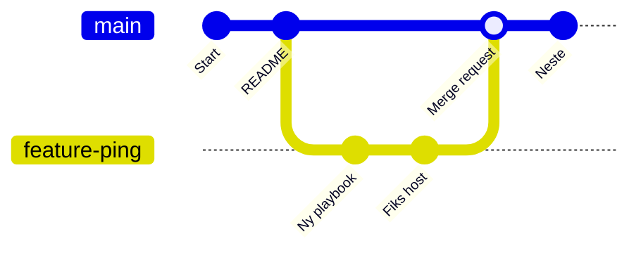
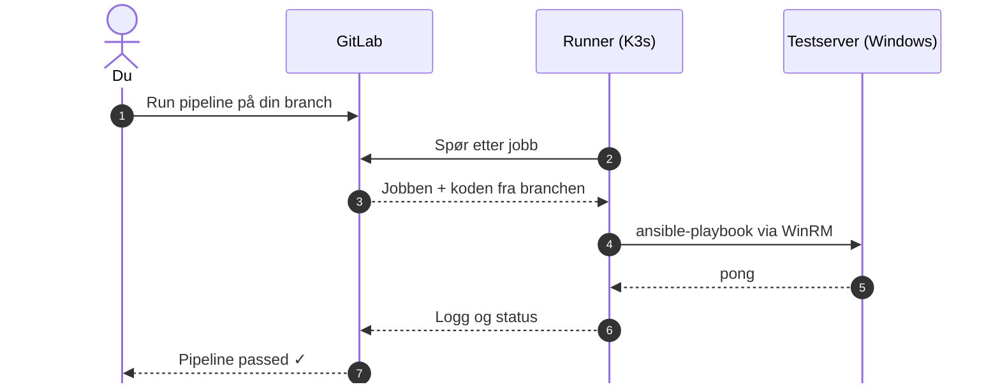

# Byggteknisk

## Automation workshop

<p class="muted text-xl">VS Code · Git · GitLab · Runner · ProGet · Ansible</p>

<!--
Velkommen! Kort presentasjon av meg selv og dagen.
-->

---
layout: default
---

# Mål for dagen

<p class="lead reveal">Etter i dag skal du kjenne igjen verktøykjeden vi bruker til automasjon – og ha kjørt din første pipeline selv.</p>

<div class="card-grid">
<div class="card accent reveal" style="--c:var(--vscode)"><div class="badge" style="--c:var(--vscode)">1</div><h4>Forstå helheten</h4><p>Hvordan VS Code, GitLab, runner, ProGet og Ansible henger sammen</p></div>
<div class="card accent reveal" style="--c:var(--gitlab)"><div class="badge" style="--c:var(--gitlab)">2</div><h4>Bruke Git og GitLab</h4><p>Klone et repo, lage en branch og dele endringer</p></div>
<div class="card accent reveal" style="--c:var(--ansible)"><div class="badge" style="--c:var(--ansible)">3</div><h4>Kjøre Ansible</h4><p>Starte en pipeline som pinger en Windows-testserver</p></div>
</div>

<div class="admonition info reveal" style="margin-top:20px">
Mest <strong>se og lytte</strong> i dag – med mange demoer. Hands-on kommer på slutten.
</div>

<!--
Sett forventninger: dette er en introduksjon. Ingen trenger å kunne noe av dette fra før.
Det er lov å spørre underveis.
-->

---
layout: default
---

# Agenda

<div class="agenda">
<div class="item reveal"><div class="num">1</div>Helheten – verktøykjeden</div>
<div class="item reveal"><div class="num">2</div>VS Code og Git <span class="tag">FOKUS</span></div>
<div class="item reveal"><div class="num">3</div>GitLab og dokumentasjon i Git <span class="tag">FOKUS</span></div>
<div class="item reveal"><div class="num">4</div>GitLab Runner</div>
<div class="item reveal"><div class="num">5</div>ProGet</div>
<div class="item reveal"><div class="num">6</div>Ansible <span class="tag">FOKUS</span></div>
<div class="item reveal"><div class="num">7</div>Hands-on: din første pipeline</div>
</div>

<p class="small muted reveal" style="margin-top:16px">☕ Pauser og lunsj tar vi underveis når det passer.</p>

<!--
Ingen faste klokkeslett – vi tilpasser tempoet til gruppen.
-->

---
layout: default
topic: Helheten
---

# Helheten

<BigPicture />

<p class="small muted" style="margin-top:6px">Du skriver kode i <strong>VS Code</strong> og pusher med <strong>Git</strong> til <strong>GitLab</strong> → GitLab starter en <strong>pipeline</strong> → <strong>runner-serveren</strong> kjører jobben mot serverne. <strong>ProGet</strong> (egen server) lagrer feeds og assets som automasjonen bruker.</p>

<!--
Dette bildet kommer igjen gjennom hele dagen – vi zoomer inn på én boks om gangen.
Gå gjennom fra venstre mot høyre:
- VS Code på din PC, der du skriver og redigerer. Git sender koden til GitLab.
- GitLab: felles lagring av koden, og der pipelines startes.
- Runner-serveren: en egen server med K3s som gjør selve jobben. Hver jobb kjører i en container. Ingen logger på den – den styres fra GitLab.
- Ansible kjører i containeren på runneren og snakker med Windows-serveren over WinRM.
- ProGet: egen server og intern lagerplass. Runneren henter container-images derfra, og serverne henter assets (installasjonsfiler) derfra.
-->

---
layout: default
topic: Helheten
---

# Ord vi bruker i dag

<div class="card-grid" style="--cols:4">
<div class="card reveal"><h4>Repo</h4><p>En mappe med kode og hele historikken</p></div>
<div class="card reveal"><h4>Commit</h4><p>Et lagret øyeblikksbilde av endringene dine</p></div>
<div class="card reveal"><h4>Branch</h4><p>En egen «gren» der du kan jobbe uten å påvirke main</p></div>
<div class="card reveal"><h4>Merge request</h4><p>Forslag om å flette en branch inn i main</p></div>
<div class="card reveal"><h4>Pipeline</h4><p>Automatiske jobber GitLab kjører for deg</p></div>
<div class="card reveal"><h4>Runner</h4><p>Serveren som faktisk kjører jobbene</p></div>
<div class="card reveal"><h4>Playbook</h4><p>Ansible-fil som beskriver hva som skal gjøres</p></div>
<div class="card reveal"><h4>Inventory</h4><p>Liste over serverne Ansible skal jobbe mot</p></div>
</div>

<!--
Ikke pugg dette nå – vi går gjennom alle ordene i løpet av dagen. Sliden er grei å komme tilbake til.
-->

---
layout: section
---

# VS Code og Git

## Editoren der alt starter

---
layout: default
topic: VS Code
---

# Du er her: VS Code

<BigPicture focus="vscode" />

<!--
Alt arbeid med koden starter lokalt, på din egen PC, i VS Code.
-->

---
layout: default
topic: VS Code
---

# Hva er VS Code?

<p class="lead reveal">Gratis kode-editor fra Microsoft – <strong>editor, terminal og Git</strong> i samme vindu.</p>

<div class="card-grid">
<div class="card accent reveal" style="--c:var(--vscode)"><h4>✏️ Editor</h4><p>Fargekoding, autofullføring og feilmarkering for YAML, PowerShell m.m.</p></div>
<div class="card accent reveal" style="--c:var(--vscode)"><h4>⌨️ Terminal</h4><p>PowerShell rett i editoren – i riktig mappe</p></div>
<div class="card accent reveal" style="--c:var(--git)"><h4>🌿 Git innebygd</h4><p>Se endringer, commit, push og pull uten kommandoer</p></div>
<div class="card accent reveal" style="--c:var(--sp-primary)"><h4>🧩 Extensions</h4><p>Godkjente tillegg for Ansible, PowerShell, Copilot m.m.</p></div>
<div class="card accent reveal" style="--c:var(--sp-primary)"><h4>📝 Markdown</h4><p>Skriv dokumentasjon med forhåndsvisning</p></div>
<div class="card accent reveal" style="--c:var(--sp-primary)"><h4>🔍 Søk overalt</h4><p>Finn tekst og filer i hele repoet</p></div>
</div>

<!--
VS Code er ikke det samme som Visual Studio – det er en lettere editor.
For oss er poenget at alt vi trenger for automasjon er samlet på ett sted.
-->

---
layout: default
topic: VS Code
clicks: 7
---

# Vinduet i VS Code

<VscodeAnatomy :step="$clicks" />

<!--
Skissen følger standardtemaet «Dark Modern» i dagens VS Code.
[click] Activity Bar: ikonene til venstre bytter visning – Explorer, søk, Source Control (Git), Run and Debug og Extensions.
[click] Primary Side Bar: viser innholdet i valgt visning. Her: filene i repoet.
[click] Editor: filene du har åpne, i faner. Du kan dele vinduet i flere editorer.
[click] Panel: terminalen ligger her, sammen med Problems og Output.
[click] Status Bar: viser blant annet hvilken branch du står på. Klikk på branch-navnet for å bytte eller lage ny.
[click] Command Center øverst: klikk eller trykk Ctrl+Shift+P for Command Palette. Alt VS Code kan gjøre finnes her.
[click] Secondary Side Bar til høyre: her ligger Copilot Chat. Kan lukkes hvis du ikke bruker den.
-->

---
layout: default
topic: VS Code
---

# Åpne en mappe – ikke enkeltfiler

<div class="flow" style="margin-top:6px">
<div class="node reveal" style="--c:var(--vscode)"><div class="badge" style="--c:var(--vscode)">📂</div><b>File → Open Folder</b><span>Velg mappen med repoet</span></div>
<div class="arrow">➜</div>
<div class="node reveal" style="--c:var(--sp-warning)"><div class="badge" style="--c:color-mix(in srgb, var(--sp-warning) 55%, black)">🛡️</div><b>Workspace Trust</b><span>Svar «Yes, I trust the authors» for repoer du kjenner</span></div>
<div class="arrow">➜</div>
<div class="node reveal" style="--c:var(--sp-primary)"><div class="badge">🗂️</div><b>Explorer</b><span>Alle filene i repoet vises i sidepanelet</span></div>
<div class="arrow">➜</div>
<div class="node reveal" style="--c:var(--git)"><div class="badge" style="--c:var(--git)">🌿</div><b>Git oppdaget</b><span>VS Code ser <code>.git</code>-mappen – Source Control blir aktiv</span></div>
</div>

<div class="columns-2-top" style="margin-top:22px">
<div class="admonition tip reveal">Mappen = repoet = arbeidsflaten din i VS Code.</div>
<div class="admonition info reveal">Terminalen åpnes automatisk i samme mappe.</div>
</div>

<!--
Vanlig nybegynnerfeil: å åpne én fil fra Utforsker. Da mister du Git-integrasjonen og extensions som forstår hele prosjektet.
Workspace Trust: VS Code spør om du stoler på innholdet i mappen før extensions og oppgaver får kjøre kode.
-->

---
layout: two-cols-header
topic: VS Code
---

# Snarveier verdt å huske

::left::

<div class="keys">
<span><kbd>Ctrl</kbd>+<kbd>Shift</kbd>+<kbd>P</kbd></span><span>Command Palette – <strong>alt</strong> finnes her</span>
<span><kbd>Ctrl</kbd>+<kbd>P</kbd></span><span>Åpne fil på navn</span>
<span><kbd>Ctrl</kbd>+<kbd>S</kbd></span><span>Lagre</span>
<span><kbd>Ctrl</kbd>+<kbd>B</kbd></span><span>Vis/skjul Side Bar</span>
<span><kbd>Ctrl</kbd>+<kbd>Shift</kbd>+<kbd>F</kbd></span><span>Søk i alle filer</span>
</div>

::right::

<div class="keys">
<span><kbd>Ctrl</kbd>+<kbd>Shift</kbd>+<kbd>E</kbd></span><span>Explorer</span>
<span><kbd>Ctrl</kbd>+<kbd>Shift</kbd>+<kbd>G</kbd></span><span>Source Control (Git)</span>
<span><kbd>Ctrl</kbd>+<kbd>Shift</kbd>+<kbd>X</kbd></span><span>Extensions</span>
<span><kbd>Ctrl</kbd>+<kbd>Shift</kbd>+<kbd>V</kbd></span><span>Forhåndsvis Markdown</span>
<span><strong>View → Terminal</strong></span><span>Åpne terminalen</span>
</div>

::bottom::

<div class="admonition info" style="margin-top:14px">
Husker du bare én: <kbd>Ctrl</kbd>+<kbd>Shift</kbd>+<kbd>P</kbd> – skriv det du vil gjøre, f.eks. «git clone».
</div>

<!--
Snarveien for terminalen avhenger av tastaturoppsettet, så vi bruker menyen View → Terminal.
-->

---
layout: two-cols-header
topic: VS Code
ratio: "45%"
---

# Den integrerte terminalen

::left::

<ul>
<li class="reveal">Åpnes i <strong>panelet</strong> nederst – i mappen du har åpen</li>
<li class="reveal">Standard på Windows er <strong>PowerShell</strong></li>
<li class="reveal">Flere terminaler samtidig med <strong>+</strong></li>
<li class="reveal">Alle <code>git</code>-kommandoer fungerer her</li>
</ul>

::right::

```powershell
PS C:\kode\demo-repo> git status
On branch main
Your branch is up to date with 'origin/main'.

nothing to commit, working tree clean
```

<p class="xs muted" style="margin-top:6px">Samme terminal som du kjenner – bare inne i editoren.</p>

<!--
Dere kan allerede PowerShell, så dette er kjent terreng. Forskjellen er at terminalen står i riktig mappe automatisk.
-->

---
layout: default
topic: Git
---

# Git – versjonskontroll

<p class="lead reveal">Git tar <strong>øyeblikksbilder</strong> (commits) av filene dine. Hver commit vet <em>hvem</em>, <em>hva</em>, <em>når</em> – og <em>hvorfor</em>.</p>

<svg viewBox="0 0 1720 230" style="width:100%" class="diagram reveal">
<defs>
<marker id="ah-c" viewBox="0 0 10 10" refX="8" refY="5" markerWidth="6" markerHeight="6" orient="auto"><path d="M0 0 L10 5 L0 10z" style="fill:var(--sp-primary)"/></marker>
</defs>
<line x1="60" y1="70" x2="1660" y2="70" style="stroke:var(--sp-primary)" stroke-width="6" marker-end="url(#ah-c)"/>
<g style="fill:var(--sp-background);stroke:var(--git)" stroke-width="7">
<circle cx="200" cy="70" r="26"/><circle cx="560" cy="70" r="26"/><circle cx="920" cy="70" r="26"/><circle cx="1280" cy="70" r="26"/>
</g>
<g font-size="26" text-anchor="middle" style="fill:currentColor">
<text x="200" y="150">Første versjon</text><text x="560" y="150">La til playbook</text><text x="920" y="150">Endret testserver</text><text x="1280" y="150">Fikset skrivefeil</text>
</g>
<g font-size="22" text-anchor="middle" style="fill:currentColor;opacity:.6">
<text x="200" y="190">Kari · man 09:12</text><text x="560" y="190">Ola · man 14:30</text><text x="920" y="190">Kari · tir 10:05</text><text x="1280" y="190">Ola · tir 13:47</text>
</g>
</svg>

<div class="columns-3-top" style="margin-top:12px">
<div class="admonition tip reveal">Full historikk</div>
<div class="admonition tip reveal">Gå tilbake til en tidligere versjon</div>
<div class="admonition tip reveal">Flere kan jobbe parallelt</div>
</div>

<!--
Sammenlign med «playbook_v2_final_NY.yml» – Git løser det problemet.
Git er et verktøy som kjører lokalt. GitLab, som vi ser på etterpå, er serveren der vi deler koden.
-->

---
layout: default
topic: Git
clicks: 4
---

# Git – fra endring til GitLab

<GitAreas :step="$clicks" />

<p class="small muted" style="margin-top:14px">Alt til venstre skjer på din PC. Først med <code>git push</code> ser andre endringene dine.</p>

<!--
[click] git add: velg hvilke endringer som skal være med i neste commit (staging).
[click] git commit: lagre et øyeblikksbilde i den lokale historikken, med en melding.
[click] git push: send commitene dine til GitLab.
[click] git clone henter hele repoet første gang. git pull henter nye endringer fra andre.
-->

---
layout: two-cols-header
topic: Git
ratio: "55%"
---

# Første gang: fortell Git hvem du er

::left::

```powershell
# Navn og e-post havner i hver commit
git config --global user.name  "Kari Nordmann"
git config --global user.email "kari.nordmann@example.no"

# Sjekk hva som er satt
git config --global --list
```

::right::

<ul>
<li class="reveal">Gjøres <strong>én gang</strong> per PC</li>
<li class="reveal">Brukes for å vise <em>hvem</em> som har gjort hva</li>
<li class="reveal">Bruk jobb-e-posten din</li>
</ul>

<!--
Hvis dette ikke er satt, stopper Git ved første commit og ber deg sette det.
-->

---
layout: two-cols-header
topic: Git
ratio: "58%"
---

# Git i terminalen – det du trenger

::left::

```powershell {all|1|2|3|4-5|6|7}
git clone <url>                  # hent repoet første gang
git switch -c feature-ping       # lag ny branch og bytt til den
git status                       # hva er endret?
git add .                        # legg alle endringer i staging
git commit -m "Legg til ping"    # lagre et øyeblikksbilde
git push -u origin feature-ping  # send branchen til GitLab
git pull                         # hent andres endringer
```

::right::

<div class="card accent" style="--c:var(--git)">
<h4>Tommelfingerregler</h4>
<ul class="small">
<li><code>git status</code> ofte – den forteller hva du bør gjøre</li>
<li>Små commits med beskrivende meldinger</li>
<li><code>git pull</code> før du starter på noe nytt</li>
</ul>
</div>

<!--
[click] clone: kopierer hele repoet med historikk fra GitLab.
[click] switch -c: lager en ny branch. (Eldre syntaks: git checkout -b.)
[click] status: den viktigste kommandoen – vis den ofte.
[click] add og commit: velg endringer, og lagre dem med en melding.
[click] push -u: første gang en ny branch pushes, må vi si hvor den skal (origin). Senere holder det med git push.
[click] pull: hent det andre har pushet.
-->

---
layout: two-cols-header
topic: Git
ratio: "52%"
---

# Git i VS Code – uten kommandoer

::left::

<div class="steps">
<div class="s reveal"><div class="n">1</div><div><strong>Branch:</strong> klikk branch-navnet nederst til venstre → <em>Create new branch</em></div></div>
<div class="s reveal"><div class="n">2</div><div><strong>Stage:</strong> trykk <strong>+</strong> ved filen i Source Control</div></div>
<div class="s reveal"><div class="n">3</div><div><strong>Melding:</strong> skriv hva du har gjort</div></div>
<div class="s reveal"><div class="n">4</div><div><strong>Commit</strong></div></div>
<div class="s reveal"><div class="n">5</div><div><strong>Publish Branch / Sync:</strong> push til GitLab</div></div>
</div>

::right::

<SourceControlMock />

<!--
Source Control åpnes med Ctrl+Shift+G, eller grenikonet i Activity Bar.
Bokstavene bak filene: M = endret (modified), A = lagt til, U = ny fil som Git ikke følger ennå (untracked).
Publish Branch dukker opp første gang en ny branch skal til GitLab. Etterpå heter knappen Sync Changes.
Graph nederst viser commitene og hvilken branch de ligger på.
Copilot-ikonet i meldingsfeltet kan foreslå en commit-melding.
-->

---
layout: default
topic: Git
---

# Terminal eller GUI? Begge gjør det samme

| Hva vil du gjøre? | Terminal | VS Code GUI |
| --- | --- | --- |
| Hente repoet | `git clone <url>` | <kbd>Ctrl</kbd>+<kbd>Shift</kbd>+<kbd>P</kbd> → **Git: Clone** |
| Lage branch | `git switch -c <navn>` | Branch-navnet i Status Bar → **Create new branch** |
| Se endringer | `git status` / `git diff` | Source Control → klikk på filen |
| Stage | `git add <fil>` | **+** ved filen |
| Commit | `git commit -m "..."` | Skriv melding → **Commit** |
| Push | `git push` | **Sync Changes** / **Publish Branch** |
| Hente endringer | `git pull` | **Sync Changes** |

<p class="small muted" style="margin-top:12px">Velg det du liker best. VS Code kjører de samme Git-kommandoene bak kulissene.</p>

<!--
Mange bruker en blanding: GUI for daglig arbeid, terminalen når noe er uklart.
Tips: Output-panelet → Git viser hvilke kommandoer VS Code faktisk kjører.
-->

---
layout: default
topic: Extensions
---

# Extensions – utvid VS Code

<p class="lead reveal">VS Code er lite i utgangspunktet. <strong>Extensions</strong> legger til støtte for språk, verktøy og tjenester.</p>

<div class="flow">
<div class="node reveal"><div class="badge">🔤</div><b>Språkstøtte</b><span>Fargekoding og autofullføring for YAML, PowerShell, Ansible</span></div>
<div class="arrow">+</div>
<div class="node reveal"><div class="badge" style="--c:var(--sp-warning);color:#000">⚠️</div><b>Validering</b><span>Feil markeres mens du skriver – før pipelinen feiler</span></div>
<div class="arrow">+</div>
<div class="node reveal"><div class="badge" style="--c:#333">🤖</div><b>Hjelp og verktøy</b><span>F.eks. GitHub Copilot, diagrammer og ikoner</span></div>
</div>

<div class="columns-2-top" style="margin-top:20px">
<div class="card reveal"><h4>Slik installerer du</h4><p><kbd>Ctrl</kbd>+<kbd>Shift</kbd>+<kbd>X</kbd> → søk på navn eller ID → <strong>Install</strong></p></div>
<div class="admonition warning reveal">Bare <strong>godkjente</strong> extensions er tillatt – se neste slide.</div>
</div>

<!--
Extensions kjører kode på PC-en din. Derfor har vi en fast liste over hva som er lov å installere.
-->

---
layout: default
topic: Extensions
---

# Godkjente extensions

<div class="card-grid ext-groups" style="--cols:2">
<div class="card accent reveal" style="--c:var(--ansible)"><h4>🅰️ Ansible og PowerShell</h4>
<div class="ext"><b>Ansible</b><code>redhat.ansible</code></div>
<div class="ext"><b>Ansible Vault</b><code>ipierre1.ansible-vault-vscode</code></div>
<div class="ext"><b>PowerShell</b><code>ms-vscode.powershell</code></div>
</div>
<div class="card accent reveal" style="--c:var(--sp-primary)"><h4>🤖 AI-assistent</h4>
<div class="ext"><b>GitHub Copilot</b><code>github.copilot</code></div>
<div class="ext"><b>GitHub Copilot Chat</b><code>github.copilot-chat</code></div>
</div>
<div class="card accent reveal" style="--c:var(--git)"><h4>📝 Markdown og dokumentasjon</h4>
<div class="ext"><b>markdownlint</b><code>davidanson.vscode-markdownlint</code></div>
<div class="ext"><b>Mermaid i Markdown</b><code>bierner.markdown-mermaid</code></div>
<div class="ext"><b>Draw.io</b><code>hediet.vscode-drawio</code></div>
<div class="ext"><b>Marp</b><code>marp-team.marp-vscode</code></div>
<div class="ext"><b>MDX</b><code>unifiedjs.vscode-mdx</code></div>
</div>
<div class="card accent reveal" style="--c:var(--border)"><h4>🎨 Annet</h4>
<div class="ext"><b>Material Icon Theme</b><code>pkief.material-icon-theme</code></div>
<div class="ext"><b>ESLint</b><code>dbaeumer.vscode-eslint</code></div>
</div>
</div>

<style>
.ext-groups { grid-auto-rows: auto; gap: 10px; }
.ext-groups .card { padding: 10px 14px; }
.ext-groups h4 { font-size: 1rem; margin-bottom: 4px; }
.ext { display: flex; justify-content: space-between; gap: 10px; font-size: 0.78rem; line-height: 1.55; }
.ext code { font-size: 0.7rem; opacity: 0.75; }
</style>

<!--
Dette er hele listen over extensions vi har lov til å installere.
Søk gjerne på ID-en i Extensions-visningen, så får du riktig extension og ikke en kopi med lignende navn.
-->

---
layout: default
topic: Extensions
---

# De viktigste for oss i dag

<div class="card-grid" style="--cols:2">
<div class="card accent reveal" style="--c:var(--ansible)"><h4><span class="i-vscode-icons:file-type-ansible" /> Ansible</h4><p>Fargekoding, autofullføring og dokumentasjon for playbooks og moduler. Fanger feil innrykk i YAML.</p></div>
<div class="card accent reveal" style="--c:var(--pwsh)"><h4><span class="i-vscode-icons:file-type-powershell" /> PowerShell</h4><p>IntelliSense, kjøring og feilsøking av PowerShell-skript</p></div>
<div class="card accent reveal" style="--c:var(--git)"><h4><span class="i-vscode-icons:file-type-markdown" /> markdownlint</h4><p>Tips om god Markdown når du skriver README og dokumentasjon</p></div>
<div class="card accent reveal" style="--c:var(--sp-primary)"><h4><span class="i-vscode-icons:file-type-markdown" /> Mermaid i Markdown</h4><p>Viser Mermaid-diagrammer i Markdown-forhåndsvisningen (<kbd>Ctrl</kbd>+<kbd>Shift</kbd>+<kbd>V</kbd>)</p></div>
</div>

<div class="admonition info reveal" style="margin-top:18px">
Ingen extension for GitLab: pipelines startes og følges i <strong>GitLab i nettleseren</strong>.
</div>

<!--
Git (clone, commit, push, pull) er innebygd i VS Code og trenger ingen extension.
Alt som har med pipelines å gjøre, gjør vi i GitLab i nettleseren.
-->

---
layout: center
topic: VS Code
---

<DemoCard title="VS Code og Git" :items="['Åpne en mappe og stol på den', 'Explorer, editor og faner', 'Command Palette: Ctrl+Shift+P', 'Terminalen: <code>git status</code>', 'Installere Ansible-extensionen', 'Source Control: endring → commit']" />

<!--
Demo i VS Code. Bruk demo-repoet eller en tom testmappe med git init.
Vis at en endring i en fil dukker opp i Source Control med M, og at git status i terminalen sier det samme.
-->

---
layout: section
---

# GitLab

## Felles hjem for koden

---
layout: default
topic: GitLab
---

# Du er her: GitLab

<BigPicture focus="gitlab" />

<!--
GitLab er midtpunktet: koden ligger her, og herfra startes automasjonen.
-->

---
layout: default
topic: GitLab
---

# Hva er GitLab?

<p class="lead reveal">En web-tjeneste for <strong>Git-repoer</strong>, <strong>samarbeid</strong> og <strong>automatisering (CI/CD)</strong>. Vår ligger på <code>gitlab.sikt.sykehuspartner.no</code>.</p>

<div class="card-grid">
<div class="card accent reveal" style="--c:var(--gitlab)"><h4>📁 Repository</h4><p>Filene og hele historikken – i nettleseren</p></div>
<div class="card accent reveal" style="--c:var(--gitlab)"><h4>🌿 Branches</h4><p>Se alle grener og hvem som jobber med hva</p></div>
<div class="card accent reveal" style="--c:var(--gitlab)"><h4>🔀 Merge requests</h4><p>Foreslå, diskutere og godkjenne endringer</p></div>
<div class="card accent reveal" style="--c:var(--sp-primary)"><h4>▶️ CI/CD</h4><p>Pipelines som kjører automasjonen</p></div>
<div class="card accent reveal" style="--c:var(--sp-primary)"><h4>🔐 Tilganger</h4><p>Hvem kan se, endre og kjøre hva</p></div>
<div class="card accent reveal" style="--c:var(--sp-primary)"><h4>📝 Dokumentasjon</h4><p>README og Markdown vises pent i nettleseren</p></div>
</div>

<!--
Git er verktøyet. GitLab er tjenesten der vi deler koden og samarbeider.
-->

---
layout: default
topic: GitLab
---

# Git og GitLab – hvem gjør hva?

<svg viewBox="0 0 1720 400" style="width:100%" class="diagram">
<defs>
<marker id="ah-g" viewBox="0 0 10 10" refX="8" refY="5" markerWidth="6" markerHeight="6" orient="auto"><path d="M0 0 L10 5 L0 10z" style="fill:var(--sp-primary)"/></marker>
</defs>
<g font-size="30" text-anchor="middle" style="fill:currentColor">
<rect x="20" y="40" width="380" height="140" rx="18" style="fill:var(--surface);stroke:var(--vscode)" stroke-width="3"/>
<text x="210" y="102" font-weight="700">💻 Din PC</text>
<text x="210" y="145" font-size="24" style="opacity:.75">VS Code + Git</text>
<rect x="20" y="230" width="380" height="140" rx="18" style="fill:var(--surface);stroke:var(--vscode)" stroke-width="3"/>
<text x="210" y="292" font-weight="700">💻 Kollega</text>
<text x="210" y="335" font-size="24" style="opacity:.75">VS Code + Git</text>
<rect x="660" y="90" width="400" height="230" rx="22" style="fill:color-mix(in srgb, var(--gitlab) 14%, transparent);stroke:var(--gitlab)" stroke-width="4"/>
<text x="860" y="170" font-size="36" font-weight="800">🦊 GitLab</text>
<text x="860" y="220" font-size="24" style="opacity:.75">Felles kopi av repoet</text>
<text x="860" y="260" font-size="24" style="opacity:.75">«origin»</text>
<rect x="1320" y="120" width="380" height="170" rx="18" style="fill:var(--surface);stroke:var(--sp-primary)" stroke-width="3"/>
<text x="1510" y="190" font-weight="700">⚙️ Pipeline</text>
<text x="1510" y="235" font-size="24" style="opacity:.75">Runner · Ansible</text>
</g>
<g style="stroke:var(--sp-primary);fill:none" stroke-width="5" marker-end="url(#ah-g)" class="draw">
<path d="M400 100 C 520 100, 540 160, 656 170"/>
<path d="M400 300 C 520 300, 540 240, 656 240"/>
<path d="M1060 205 L1316 205"/>
</g>
<g font-size="24" text-anchor="middle" style="fill:var(--sp-primary)">
<text x="530" y="95">push / pull</text><text x="530" y="335">push / pull</text><text x="1188" y="190">starter</text>
</g>
</svg>

<div class="columns-2-top" style="margin-top:8px">
<div class="admonition info reveal"><strong>Git</strong> = verktøyet på din PC</div>
<div class="admonition info reveal"><strong>GitLab</strong> = serveren alle deler</div>
</div>

<!--
Alle har sin egen fullstendige kopi lokalt. GitLab er den felles kopien som alle synkroniserer mot.
-->

---
layout: two-cols-header
topic: GitLab
ratio: "52%"
---

# Grupper og prosjekter

::left::

<div class="nest g1 reveal">
<span class="lbl">👥 Gruppe</span>
<div class="nest g2">
<span class="lbl">👥 Undergruppe</span>
<div class="projects">
<div class="proj">📁 demo-repo</div>
<div class="proj">📁 playbooks</div>
<div class="proj">📁 dokumentasjon</div>
</div>
</div>
</div>

::right::

<ul>
<li class="reveal"><strong>Prosjekt</strong> = ett repo (pluss pipelines, MR-er osv.)</li>
<li class="reveal"><strong>Grupper</strong> samler prosjekter, som mapper</li>
<li class="reveal"><strong>Tilganger arves</strong> nedover fra gruppen</li>
<li class="reveal">Roller avgjør hva du kan gjøre, f.eks. <em>Developer</em> eller <em>Maintainer</em></li>
</ul>

<style>
.nest { border: 2px solid var(--gitlab); border-radius: 12px; padding: 30px 14px 14px; position: relative; background: color-mix(in srgb, var(--gitlab) 7%, transparent); }
.nest.g2 { border-style: dashed; margin-top: 4px; }
.nest .lbl { position: absolute; top: 6px; left: 14px; font-size: 0.85rem; font-weight: 700; }
.projects { display: flex; flex-direction: column; gap: 8px; }
.proj { background: var(--surface); border: 1px solid var(--border); border-radius: 8px; padding: 7px 12px; font-size: 0.9rem; }
</style>

<!--
Prosjektnavnene er bare eksempler.
Developer kan pushe til branches og lage merge requests. Maintainer kan i tillegg endre innstillinger og beskytte branches.
-->

---
layout: two-cols-header
topic: GitLab
ratio: "40%"
---

# En rask runde i et prosjekt

::left::

<div class="menu">
<div class="sec">Code</div>
<div class="it">Repository</div>
<div class="it">Branches</div>
<div class="it">Commits</div>
<div class="it">Merge requests</div>
<div class="sec">Build</div>
<div class="it hl">Pipelines</div>
<div class="it">Jobs</div>
<div class="sec">Settings</div>
<div class="it">CI/CD</div>
</div>

::right::

<div class="steps">
<div class="s reveal"><div class="n">📁</div><div><strong>Repository</strong> – bla i filene, se README</div></div>
<div class="s reveal"><div class="n">🕘</div><div><strong>Commits</strong> – hvem endret hva, og når</div></div>
<div class="s reveal"><div class="n">🔀</div><div><strong>Merge requests</strong> – endringer som venter på godkjenning</div></div>
<div class="s reveal"><div class="n">▶️</div><div><strong>Pipelines</strong> – kjøringer, status og logger</div></div>
<div class="s reveal"><div class="n">⚙️</div><div><strong>Settings → CI/CD</strong> – variabler og runner</div></div>
</div>

<style>
.menu { background: var(--surface); border: 1px solid var(--border); border-radius: 10px; padding: 10px 0; width: 230px; font-size: 0.9rem; }
.menu .sec { font-weight: 700; padding: 6px 16px 2px; opacity: 0.9; }
.menu .it { padding: 3px 16px 3px 30px; opacity: 0.75; }
.menu .it.hl { opacity: 1; background: color-mix(in srgb, var(--gitlab) 22%, transparent); border-left: 3px solid var(--gitlab); }
</style>

<p class="xs muted" style="margin-top:10px">Menyen til venstre i prosjektet. Navnene kan variere litt mellom GitLab-versjoner.</p>

<!--
Vis dette live i demoen. Pipelines er markert fordi det er dit vi skal i hands-on.
-->

---
layout: two-cols-header
topic: GitLab
ratio: "42%"
---

# Klone et repo til VS Code

::left::

<div class="steps">
<div class="s reveal"><div class="n">1</div><div>I GitLab: knappen <strong>Code</strong> → kopier <em>Clone with HTTPS</em> eller <em>SSH</em></div></div>
<div class="s reveal"><div class="n">2</div><div>I VS Code: <kbd>Ctrl</kbd>+<kbd>Shift</kbd>+<kbd>P</kbd> → <strong>Git: Clone</strong></div></div>
<div class="s reveal"><div class="n">3</div><div>Lim inn URL-en og velg en lokal mappe</div></div>
<div class="s reveal"><div class="n">4</div><div>Velg <strong>Open</strong> – repoet åpnes i VS Code</div></div>
</div>

::right::

<div class="reveal">
<p class="small" style="margin:0 0 6px"><strong>Eller i terminalen:</strong></p>

```powershell
cd C:\kode
git clone `
  https://gitlab.sikt.sykehuspartner.no/<gruppe>/<prosjekt>.git
cd <prosjekt>
code .
```

</div>

<div class="admonition info reveal" style="margin-top:12px">Første gang må du logge inn mot GitLab. Bruk oppsettet du har fått.</div>

<!--
HTTPS eller SSH: begge fungerer, så bruk det som er satt opp for deg.
code . åpner mappen du står i, i VS Code.
-->

---
layout: default
topic: GitLab
---

# Hva skjer når du kloner?

<svg viewBox="0 0 1720 360" style="width:100%" class="diagram">
<defs>
<marker id="ah-cl" viewBox="0 0 10 10" refX="8" refY="5" markerWidth="6" markerHeight="6" orient="auto"><path d="M0 0 L10 5 L0 10z" style="fill:var(--gitlab)"/></marker>
</defs>
<rect x="20" y="40" width="620" height="280" rx="22" style="fill:color-mix(in srgb, var(--gitlab) 12%, transparent);stroke:var(--gitlab)" stroke-width="4"/>
<text x="330" y="100" font-size="34" font-weight="800" text-anchor="middle" style="fill:currentColor">🦊 GitLab</text>
<rect x="1080" y="40" width="620" height="280" rx="22" style="fill:color-mix(in srgb, var(--vscode) 12%, transparent);stroke:var(--vscode)" stroke-width="4"/>
<text x="1390" y="100" font-size="34" font-weight="800" text-anchor="middle" style="fill:currentColor">💻 Din PC</text>
<g style="stroke:var(--git);fill:var(--sp-background)" stroke-width="6">
<line x1="110" y1="190" x2="550" y2="190"/>
<circle cx="110" cy="190" r="22"/><circle cx="257" cy="190" r="22"/><circle cx="403" cy="190" r="22"/><circle cx="550" cy="190" r="22"/>
<line x1="1170" y1="190" x2="1610" y2="190"/>
<circle cx="1170" cy="190" r="22"/><circle cx="1317" cy="190" r="22"/><circle cx="1463" cy="190" r="22"/><circle cx="1610" cy="190" r="22"/>
</g>
<text x="330" y="270" font-size="24" text-anchor="middle" style="fill:currentColor;opacity:.75">Alle commits og branches</text>
<text x="1390" y="270" font-size="24" text-anchor="middle" style="fill:currentColor;opacity:.75">Nøyaktig samme historikk</text>
<path d="M660 190 L1060 190" style="stroke:var(--gitlab);fill:none" stroke-width="7" marker-end="url(#ah-cl)" class="draw"/>
<text x="860" y="170" font-size="30" font-weight="700" text-anchor="middle" style="fill:var(--gitlab)">git clone</text>
<text x="860" y="235" font-size="22" text-anchor="middle" style="fill:currentColor;opacity:.7">husker GitLab som «origin»</text>
</svg>

<div class="columns-3-top" style="margin-top:10px">
<div class="admonition tip reveal">Hele historikken – ikke bare filene</div>
<div class="admonition tip reveal">Du kan jobbe uten nett</div>
<div class="admonition tip reveal">Gjøres bare én gang</div>
</div>

<!--
Etter clone bruker vi pull for å hente nye endringer. Vi kloner ikke på nytt.
-->

---
layout: two-cols-header
topic: GitLab
ratio: "58%"
---

# Branches – jobb trygt ved siden av main

::left::



::right::

<ul>
<li class="reveal"><strong>main</strong> er den stabile versjonen</li>
<li class="reveal">Én <strong>branch</strong> per endring</li>
<li class="reveal">Pipelines kan kjøres på din branch – uten å røre main</li>
<li class="reveal">Inn i main via <strong>merge request</strong></li>
</ul>

<!--
I hands-on skal hver av dere lage en egen branch og kjøre pipelinen på den. Ingen kan ødelegge for andre.
-->

---
layout: default
topic: GitLab
---

# Merge request – fra branch til main

<div class="timeline">
<div class="step reveal" style="--c:var(--vscode)"><div class="circle">🌿</div><b>Branch</b><span>Lag en branch for endringen</span></div>
<div class="step reveal" style="--c:var(--vscode)"><div class="circle">💾</div><b>Commit + push</b><span>Endringene sendes til GitLab</span></div>
<div class="step reveal" style="--c:var(--gitlab)"><div class="circle">🔀</div><b>Merge request</b><span>Beskriv hva og hvorfor</span></div>
<div class="step reveal" style="--c:var(--sp-warning)"><div class="circle">▶️</div><b>Pipeline</b><span>Kjører automatisk og sjekker koden</span></div>
<div class="step reveal" style="--c:var(--sp-warning)"><div class="circle">👀</div><b>Review</b><span>En kollega ser over</span></div>
<div class="step reveal" style="--c:var(--sp-success)"><div class="circle">✅</div><b>Merge</b><span>Endringen er i main</span></div>
</div>

<div class="admonition info reveal" style="margin-top:28px">
Fire øyne på hver endring – og full historikk over <em>hva</em> som ble godkjent, av <em>hvem</em>.
</div>

<!--
Vi lager ikke merge requests i hands-on i dag, men det er det naturlige neste steget.
-->

---
layout: default
topic: Dokumentasjon i Git
---

# Dokumentasjon i Git

<p class="lead reveal">Dokumentasjonen ligger <strong>sammen med koden</strong>, som Markdown-filer i repoet.</p>

<div class="card-grid" style="--cols:4">
<div class="card accent reveal" style="--c:var(--git)"><div class="badge" style="--c:var(--git)">📍</div><h4>Der koden er</h4><p>Ingen leting i wikier og delte mapper</p></div>
<div class="card accent reveal" style="--c:var(--git)"><div class="badge" style="--c:var(--git)">🕘</div><h4>Versjonert</h4><p>Historikk og endringslogg helt gratis</p></div>
<div class="card accent reveal" style="--c:var(--gitlab)"><div class="badge" style="--c:var(--gitlab)">👀</div><h4>Review</h4><p>Endres i samme merge request som koden</p></div>
<div class="card accent reveal" style="--c:var(--gitlab)"><div class="badge" style="--c:var(--gitlab)">✨</div><h4>Pent i GitLab</h4><p><code>README.md</code> vises på forsiden av prosjektet</p></div>
</div>

<div class="admonition tip reveal" style="margin-top:20px">
Endrer du koden, oppdaterer du dokumentasjonen i <strong>samme commit</strong>.
</div>

<!--
«Docs as code». Det viktigste argumentet: dokumentasjonen blir ikke utdatert like lett, fordi den er rett ved siden av koden.
-->

---
layout: two-cols-header
topic: Dokumentasjon i Git
---

# Markdown på ett minutt

::left::

```md
# Demo-repo

Pinger testserveren med Ansible.

## Slik kjører du

1. Lag en branch
2. Kjør pipelinen

**Viktig:** ingen passord i repoet!

- [Ansible-dokumentasjon](https://docs.ansible.com)
```

::right::

<div class="card md-preview">
<h2>Demo-repo</h2>
<p>Pinger testserveren med Ansible.</p>
<h3>Slik kjører du</h3>
<ol><li>Lag en branch</li><li>Kjør pipelinen</li></ol>
<p><strong>Viktig:</strong> ingen passord i repoet!</p>
<ul><li><a>Ansible-dokumentasjon</a></li></ul>
</div>

<style>
.md-preview { font-size: 0.9rem; }
.md-preview h2 { font-size: 1.4rem; border-bottom: 1px solid var(--border); padding-bottom: 4px; margin-bottom: 8px; }
.md-preview h3 { font-size: 1.05rem; margin: 10px 0 4px; }
.md-preview p, .md-preview ol, .md-preview ul { margin: 4px 0; opacity: 1; font-size: 0.9rem; }
.md-preview a { color: var(--sp-primary); text-decoration: underline; }
</style>

<!--
Venstre: det du skriver. Høyre: slik GitLab og VS Code (Ctrl+Shift+V) viser det.
-->

---
layout: two-cols-header
topic: Dokumentasjon i Git
ratio: "48%"
---

# En god README svarer på

::left::

<div class="steps">
<div class="s reveal"><div class="n">❓</div><div><strong>Hva</strong> gjør repoet?</div></div>
<div class="s reveal"><div class="n">▶️</div><div><strong>Hvordan</strong> kjører jeg det?</div></div>
<div class="s reveal"><div class="n">🔑</div><div><strong>Hva trengs?</strong> Variabler, tilganger</div></div>
<div class="s reveal"><div class="n">👤</div><div><strong>Hvem</strong> eier det?</div></div>
</div>

::right::

<div class="reveal">
<p class="small" style="margin:0 0 6px"><strong>Bonus:</strong> GitLab og VS Code tegner diagrammer fra tekst (Mermaid):</p>

```md
~~~mermaid
flowchart LR
  GitLab --> Runner --> Testserver
~~~
```

</div>

<div class="admonition tip reveal" style="margin-top:12px">Diagrammet versjoneres som tekst, som all annen kode.</div>

<!--
Mermaid gjengis i GitLab sin Markdown-visning, og i VS Code med den godkjente extensionen «Markdown Preview Mermaid Support». Diagrammet oppdateres i samme merge request som koden.
-->

---
layout: center
topic: GitLab
---

<DemoCard title="GitLab" :items="['Finne prosjektet i gruppen', 'Bla i filer, commits og branches', 'Kopiere clone-URL', 'Klone i VS Code: Git: Clone', 'Lage branch, commit og push', 'Se branchen og README i GitLab']" />

<!--
Gå gjennom hele runden: GitLab → VS Code → tilbake til GitLab, og vis at branchen er der.
Vis at README.md vises på forsiden av prosjektet.
-->

---
layout: section
---

# GitLab Runner

## Maskinen som gjør jobben

---
layout: default
topic: Runner
---

# Du er her: Runner

<BigPicture focus="runner" />

<!--
GitLab bestemmer hva som skal kjøres. Runneren er serveren som faktisk kjører det.
-->

---
layout: two-cols-header
topic: Runner
ratio: "52%"
---

# Hva er en runner?

::left::

<ul>
<li class="reveal">Et program (<code>gitlab-runner</code>) på en <strong>egen server</strong> – ikke på GitLab-serveren</li>
<li class="reveal">Runneren <strong>spør GitLab etter jobber</strong> og henter koden fra branchen</li>
<li class="reveal">Runneren kjører kommandoene og <strong>sender logg og status</strong> tilbake</li>
<li class="reveal">Hos oss: <strong>én runner-server med K3s</strong>. Hver jobb kjører i en <strong>container</strong> – med et Ansible- eller PowerShell-image fra ProGet</li>
</ul>

<div class="admonition info reveal" style="margin-top:12px">Du logger aldri på runneren – den styres fra GitLab.</div>

::right::

<svg viewBox="0 0 700 600" style="width:100%;max-height:380px" class="diagram">
<defs>
<marker id="ah-r" viewBox="0 0 10 10" refX="8" refY="5" markerWidth="6" markerHeight="6" orient="auto"><path d="M0 0 L10 5 L0 10z" style="fill:var(--sp-primary)"/></marker>
</defs>
<rect x="150" y="10" width="400" height="140" rx="20" style="fill:color-mix(in srgb, var(--gitlab) 14%, transparent);stroke:var(--gitlab)" stroke-width="4"/>
<text x="350" y="70" font-size="34" font-weight="800" text-anchor="middle" style="fill:currentColor">🦊 GitLab</text>
<text x="350" y="112" font-size="24" text-anchor="middle" style="fill:currentColor;opacity:.75">server 1 · pipelines</text>
<rect x="150" y="440" width="400" height="150" rx="20" style="fill:color-mix(in srgb, var(--sp-primary) 14%, transparent);stroke:var(--sp-primary)" stroke-width="4"/>
<text x="350" y="502" font-size="34" font-weight="800" text-anchor="middle" style="fill:currentColor">⚙️ Runner</text>
<text x="350" y="546" font-size="24" text-anchor="middle" style="fill:currentColor;opacity:.75">server 2 · K3s</text>
<g style="stroke:var(--sp-primary);fill:none" stroke-width="5" marker-end="url(#ah-r)">
<path d="M260 156 L260 434"/>
<path d="M440 436 L440 158"/>
</g>
<g font-size="24" style="fill:currentColor">
<text x="50" y="280">① Jobb +</text><text x="50" y="312">kode</text>
<text x="456" y="280">② Logg +</text><text x="456" y="312">status</text>
</g>
</svg>

<!--
GitLab og runneren er to separate servere. Runneren spør GitLab om det finnes jobber, henter jobben og koden, gjør arbeidet og rapporterer tilbake.
GitLab kobler seg aldri til runneren – det er runneren som tar kontakt.
På runner-serveren kjører K3s (Kubernetes) med Flux. Hver jobb starter en container fra imaget som står i .gitlab-ci.yml, og containeren fjernes når jobben er ferdig.
Runneren er delt: alle prosjekter som får lov kan bruke den.
-->

---
layout: default
topic: Runner
---

# Pipeline, stages og jobber

<p class="lead reveal">En <strong>pipeline</strong> består av <strong>stages</strong> som kjører etter hverandre. Hver stage har én eller flere <strong>jobber</strong>.</p>

<div class="pipeline" style="--cols:3">
<div class="stage reveal" style="--c:var(--sp-primary)">
<div class="head">Stage: validate</div>
<div class="job"><span class="dot">✓</span>yaml-sjekk</div>
<div class="job"><span class="dot">✓</span>syntax-check</div>
</div>
<div class="stage reveal" style="--c:var(--sp-warning)">
<div class="head">Stage: test</div>
<div class="job"><span class="dot">✓</span>ping</div>
</div>
<div class="stage reveal" style="--c:var(--sp-success)">
<div class="head">Stage: deploy</div>
<div class="job manual"><span class="dot">▶</span>deploy (manuell)</div>
</div>
</div>

<div class="columns-2-top" style="margin-top:20px">
<div class="admonition info reveal">Alt defineres i <code>.gitlab-ci.yml</code> i roten av repoet.</div>
<div class="admonition tip reveal">Feiler en stage, stopper pipelinen der.</div>
</div>

<p class="xs muted" style="margin:8px 0 0">Eksempel. Demo-repoet har en enklere pipeline.</p>

<!--
Jobber i samme stage kan kjøre parallelt. Neste stage starter først når forrige stage er ferdig.
-->

---
layout: two-cols-header
topic: Runner
ratio: "54%"
---

# <code>.gitlab-ci.yml</code> – oppskriften

::left::

```yaml {all|1-2|4|5|6|7-8}
stages:
  - test

ping:
  stage: test
  image: <proget>/<feed>/ansible:<versjon>
  script:
    - ansible-playbook -i inventory.yml ping.yml
```

<p class="xs muted" style="margin-top:6px">Forenklet eksempel. Image og filnavn i demo-repoet kan være annerledes.</p>

::right::

<div class="steps">
<div class="s reveal"><div class="n">1</div><div><strong>stages</strong> – rekkefølgen</div></div>
<div class="s reveal"><div class="n">2</div><div><strong>ping</strong> – navnet på jobben</div></div>
<div class="s reveal"><div class="n">3</div><div><strong>stage</strong> – hvilken stage jobben hører til</div></div>
<div class="s reveal"><div class="n">4</div><div><strong>image</strong> – hvilket verktøy-image jobben kjører i</div></div>
<div class="s reveal"><div class="n">5</div><div><strong>script</strong> – kommandoene som kjøres i containeren</div></div>
</div>

<!--
[click] stages: listen over stages, i rekkefølge.
[click] Jobbnavnet er fritt valgt og vises i GitLab.
[click] Hvilken stage jobben tilhører.
[click] image: containeren jobben kjører i. Runneren henter imaget fra ProGet. Ansible-image for Ansible, PowerShell-image for PowerShell.
[click] script: de samme kommandoene som du ville skrevet i en terminal.
-->

---
layout: default
topic: Runner
---

# <code>image:</code> – hvilket verktøy jobben får

<div class="tagmatch">
<div class="runners">
<div class="card accent reveal" style="--c:var(--ansible)"><h4>📄 Jobb: ping</h4><p>image: <span class="chip">…/ansible:&lt;versjon&gt;</span></p></div>
<div class="card accent reveal" style="--c:var(--pwsh)"><h4>📄 Jobb: rapport</h4><p>image: <span class="chip">…/powershell:&lt;versjon&gt;</span></p></div>
</div>
<div class="arrows reveal">
<div>➜</div>
<div>➜</div>
</div>
<div class="card accent reveal" style="--c:var(--sp-primary)">
<h4>⚙️ Runner-server (K3s)</h4>
<p>Henter imaget fra <strong>ProGet</strong> og starter en <strong>container</strong> per jobb. Containeren fjernes når jobben er ferdig.</p>
</div>
</div>

<div class="admonition info reveal" style="margin-top:22px">
Samme runner for alle jobbene – det er <code>image:</code> som bestemmer om du får Ansible eller PowerShell.
</div>

<p class="xs muted" style="margin:8px 0 0">Image-navnene er eksempler. Se demo-repoet for de vi faktisk bruker.</p>

<style>
.tagmatch { display: grid; grid-template-columns: 1.3fr 80px 1fr; gap: 14px; align-items: center; }
.tagmatch .arrows { display: flex; flex-direction: column; gap: 70px; font-size: 32px; font-weight: 800; text-align: center; color: var(--sp-primary); }
.tagmatch .runners { display: flex; flex-direction: column; gap: 14px; }
.chip { display: inline-block; padding: 1px 9px; border-radius: 10px; background: color-mix(in srgb, var(--sp-primary) 22%, transparent); font-family: var(--slidev-code-font-family, monospace); font-size: 0.8rem; }
</style>

<!--
Vi bruker ikke tags for å velge verktøy. Én runner-server tar jobbene, og image: i .gitlab-ci.yml avgjør hvilken container jobben kjører i.
Imagene ligger i ProGet. I dag bruker vi Ansible-imaget.
-->

---
layout: default
topic: Runner
---

# Hva skjer når du trykker «Run pipeline»?



<!--
Følg tallene. Legg merke til at det er runneren som spør GitLab etter jobber, og at den henter koden fra akkurat din branch.
Runneren starter en container fra imaget i .gitlab-ci.yml, og Ansible kjører inne i containeren.
Det er derfor branchen må være pushet til GitLab før du kan kjøre pipelinen på den.
-->

---
layout: two-cols-header
topic: Runner
ratio: "50%"
---

# Hemmeligheter: Ansible Vault

::left::

<ul>
<li class="reveal">Passord og tokens <strong>krypteres</strong> med Ansible Vault før de committes</li>
<li class="reveal">I VS Code: extensionen <strong>Ansible Vault</strong> krypterer og dekrypterer for deg</li>
<li class="reveal">Pipelinen <strong>dekrypterer</strong> når jobben kjører – med vault-passordet</li>
<li class="reveal">Vault-passordet selv ligger <strong>aldri</strong> i repoet</li>
</ul>

::right::

<div class="card accent reveal" style="--c:var(--sp-danger)">
<h4 class="bad-text">🚫 Aldri i klartekst i Git</h4>
<p>Det som er committet, ligger i historikken for alltid – også etter at du sletter det.</p>
</div>

<div class="card accent reveal" style="--c:var(--sp-success);margin-top:12px">
<h4 class="ok-text">✓ Kryptert med Vault</h4>
<p>Trygt å committe, versjonert sammen med koden, og bare lesbart med vault-passordet.</p>
</div>

<!--
Demo-repoet har påloggingen til testserveren kryptert med Ansible Vault. Vis hvordan det ser ut i repoet og hvordan pipelinen får tak i vault-passordet.
-->

---
layout: default
topic: Runner
---

# Lese en pipeline

<div class="columns-2-top" style="align-items:center">
<div>
<div class="job pending reveal"><span class="dot">⏸</span><strong>pending</strong>&nbsp;– venter på runneren</div>
<div class="job running reveal"><span class="dot">⟳</span><strong>running</strong>&nbsp;– runneren jobber</div>
<div class="job reveal"><span class="dot">✓</span><strong>passed</strong>&nbsp;– alt gikk bra</div>
<div class="job failed reveal"><span class="dot">✗</span><strong>failed</strong>&nbsp;– noe feilet, les loggen</div>
<div class="job manual reveal"><span class="dot">▶</span><strong>manual</strong>&nbsp;– venter på at noen trykker</div>
</div>
<div>
<div class="steps">
<div class="s reveal"><div class="n">1</div><div><strong>Build → Pipelines</strong></div></div>
<div class="s reveal"><div class="n">2</div><div>Klikk på pipelinen</div></div>
<div class="s reveal"><div class="n">3</div><div>Klikk på jobben</div></div>
<div class="s reveal"><div class="n">4</div><div>Les loggen <strong>nedenfra og opp</strong></div></div>
</div>
</div>
</div>

<div class="admonition tip reveal" style="margin-top:20px">
Loggen viser nøyaktig det runneren så – samme output som i en terminal.
</div>

<!--
Feilmeldingen står nesten alltid nederst i loggen.
-->

---
layout: center
topic: Runner
---

<DemoCard title="GitLab Runner" :items="['Åpne <code>.gitlab-ci.yml</code> i demo-repoet', 'Se <code>image:</code> i jobben', 'Build → Pipelines → Run pipeline', 'Se jobben gå fra pending til running', 'Lese loggen', 'Settings → CI/CD → Runners']" />

<!--
Vis hvilken runner prosjektet har tilgang til, og hvilket image jobben bruker.
Vis i loggen at runneren henter imaget og starter containeren.
-->

---
layout: section
---

# ProGet

## Intern lagerplass for pakker og filer

---
layout: default
topic: ProGet
---

# Du er her: ProGet

<BigPicture focus="proget" />

<!--
ProGet er ikke et steg i pipelinen. Det er en egen server – et lager som automasjonen henter fra ved behov.
Runneren henter container-images (Ansible/PowerShell). Serverne henter assets, f.eks. installasjonsfiler.
-->

---
layout: default
topic: ProGet
---

# Hva er ProGet?

<p class="lead reveal">En <strong>egen server</strong> med et internt lager for pakker og filer, fra Inedo. Automasjonen henter fra ProGet i stedet for fra internett eller delte mapper.</p>

<div class="flow">
<div class="node reveal" style="--c:var(--border)"><div class="badge" style="--c:#555">🌐</div><b>Kilder</b><span>Leverandører, internett, egne bygg</span></div>
<div class="arrow">➜</div>
<div class="node reveal" style="--c:var(--proget)"><div class="badge" style="--c:var(--proget)">📦</div><b>ProGet</b><span>Lagret, versjonert og tilgangsstyrt</span></div>
<div class="arrow">➜</div>
<div class="node reveal" style="--c:var(--sp-primary)"><div class="badge">⚙️</div><b>Runner</b><span>Henter container-images, og ber serverne laste ned filer</span></div>
<div class="arrow">➜</div>
<div class="node reveal" style="--c:var(--windows)"><div class="badge" style="--c:var(--windows)">🖥️</div><b>Servere</b><span>Henter installasjonsfilene direkte fra ProGet</span></div>
</div>

<div class="columns-3-top" style="margin-top:20px">
<div class="admonition tip reveal">Én kontrollert kilde</div>
<div class="admonition tip reveal">Samme fil hver gang</div>
<div class="admonition tip reveal">Tilgjengelig internt</div>
</div>

<!--
Poenget: automasjonen skal være forutsigbar. Henter vi fra internett, kan filen endre seg eller forsvinne. I ProGet har vi kontroll.
-->

---
layout: two-cols-header
topic: ProGet
---

# Feeds og assets

::left::

<div class="card accent reveal" style="--c:var(--sp-primary)">
<h4>📚 Feeds</h4>
<p style="margin-bottom:8px">Pakker av en bestemt <strong>type</strong>, med navn, versjon og metadata.</p>
<ul class="small">
<li>F.eks. Docker (container-images), NuGet/PowerShell, PyPI, npm</li>
<li>Hentes med pakkeverktøyet, f.eks. <code>Install-Module</code> eller <code>pip</code></li>
<li>Kan speile offentlige kilder</li>
</ul>
</div>

::right::

<div class="card accent reveal" style="--c:var(--proget)">
<h4>🗃️ Assets <span class="xs muted">(asset directories)</span></h4>
<p style="margin-bottom:8px">Vanlige <strong>filer i mapper</strong> – uansett type.</p>
<ul class="small">
<li>F.eks. <code>.msi</code>, <code>.exe</code>, <code>.zip</code>, <code>.iso</code></li>
<li>Hentes med en <strong>vanlig URL</strong></li>
<li><strong>Det vi bruker mest</strong> – binærfiler</li>
</ul>
</div>

::bottom::

<div class="admonition info reveal" style="margin-top:14px">
Tommelfingerregel: <strong>pakke</strong> med pakkeverktøy → feed. <strong>Fil</strong> du bare skal laste ned → asset.
</div>

<!--
Vi bruker mest asset directories, for installasjonsfiler og andre binærfiler som serverne trenger.
-->

---
layout: two-cols-header
topic: ProGet
ratio: "62%"
---

# ProGet i automasjon

::left::

```yaml {all|1-4|6-9}
- name: Last ned installasjonsfilen fra ProGet
  ansible.windows.win_get_url:
    url: https://<proget>/endpoints/<mappe>/content/setup.msi
    dest: C:\Temp\setup.msi

- name: Installer
  ansible.windows.win_package:
    path: C:\Temp\setup.msi
    state: present
```

<p class="xs muted" style="margin-top:6px">Eksempel med plassholdere i URL-en.</p>

::right::

<div class="steps">
<div class="s reveal"><div class="n">1</div><div><strong>Ansible på runneren</strong> ber serveren laste ned filen</div></div>
<div class="s reveal"><div class="n">2</div><div><strong>Serveren</strong> henter filen direkte fra <strong>ProGet</strong></div></div>
<div class="s reveal"><div class="n">3</div><div>Ansible installerer – bare hvis den mangler</div></div>
</div>

<div class="admonition tip reveal" style="margin-top:14px">Ny versjon? Last opp til ProGet og endre URL-en i én commit.</div>

<!--
[click] win_get_url kjører på Windows-serveren, ikke på runneren. Ansible sender instruksen, og serveren laster ned filen fra ProGet selv. Serveren må derfor nå ProGet over nettet.
[click] win_package installerer. state: present betyr «sørg for at den er installert». Er den det allerede, skjer ingenting.
-->

---
layout: center
topic: ProGet
---

<DemoCard title="ProGet" :items="['Rundtur i ProGet', 'Se en feed og en pakke', 'Åpne en asset directory', 'Kopiere URL-en til en fil', 'Vise hvor URL-en brukes i en playbook']" />

<!--
Fokuser på assets, siden det er det vi bruker mest.
-->

---
layout: section
---

# Ansible

## Scratch the surface

---
layout: default
topic: Ansible
---

# Du er her: Ansible

<BigPicture focus="ansible" />

<!--
Ansible kjører i en container på runneren og snakker med Windows-serveren over WinRM.
-->

---
layout: default
topic: Ansible
---

# Hva er Ansible?

<p class="lead reveal">Et verktøy for å <strong>beskrive</strong> hva som skal gjøres på servere, i lesbar YAML – og <strong>gjøre det</strong>, likt hver gang.</p>

<div class="card-grid">
<div class="card accent reveal" style="--c:var(--ansible)"><div class="badge" style="--c:var(--ansible)">🪶</div><h4>Agentløst</h4><p>Ingen agent å installere – Windows nås over WinRM, som er innebygd</p></div>
<div class="card accent reveal" style="--c:var(--ansible)"><div class="badge" style="--c:var(--ansible)">📄</div><h4>YAML</h4><p>Lesbart for mennesker, kjørbart for maskiner</p></div>
<div class="card accent reveal" style="--c:var(--ansible)"><div class="badge" style="--c:var(--ansible)">🔁</div><h4>Idempotent</h4><p>Endrer bare det som ikke allerede er riktig</p></div>
<div class="card accent reveal" style="--c:var(--sp-primary)"><div class="badge">🧩</div><h4>Moduler</h4><p>Ferdige byggeklosser for tjenester, pakker, filer m.m.</p></div>
<div class="card accent reveal" style="--c:var(--sp-primary)"><div class="badge">🐧🪟</div><h4>Linux og Windows</h4><p>Samme verktøy og arbeidsmåte for begge</p></div>
<div class="card accent reveal" style="--c:var(--sp-primary)"><div class="badge">📈</div><h4>Skalerer</h4><p>Én server eller hundre – samme playbook</p></div>
</div>

<!--
Ansible er open source og utviklet av Red Hat.
Sammenlignet med PowerShell-skript: du beskriver ønsket resultat, og modulene tar seg av sjekkene.
-->

---
layout: default
topic: Ansible
---

# Slik henger det sammen

<svg viewBox="0 0 1720 470" style="width:100%" class="diagram">
<defs>
<marker id="ah-a" viewBox="0 0 10 10" refX="8" refY="5" markerWidth="6" markerHeight="6" orient="auto"><path d="M0 0 L10 5 L0 10z" style="fill:var(--sp-success)"/></marker>
</defs>
<rect x="10" y="10" width="820" height="450" rx="22" style="fill:color-mix(in srgb, var(--sp-primary) 10%, transparent);stroke:var(--sp-primary)" stroke-width="4"/>
<text x="40" y="62" font-size="32" font-weight="800" style="fill:currentColor">⚙️ Container på runneren – «control node»</text>
<g font-size="28" style="fill:currentColor">
<rect x="40" y="100" width="340" height="140" rx="14" style="fill:var(--surface);stroke:var(--border)" stroke-width="2"/>
<text x="65" y="155" font-weight="700">📋 Inventory</text>
<text x="65" y="200" font-size="22" style="opacity:.75">Hvilke servere?</text>
<rect x="40" y="280" width="340" height="140" rx="14" style="fill:var(--surface);stroke:var(--border)" stroke-width="2"/>
<text x="65" y="335" font-weight="700">▶️ Playbook</text>
<text x="65" y="380" font-size="22" style="opacity:.75">Hva skal gjøres?</text>
<rect x="460" y="170" width="340" height="180" rx="18" style="fill:color-mix(in srgb, var(--ansible) 18%, transparent);stroke:var(--ansible)" stroke-width="4"/>
<text x="630" y="245" font-size="34" font-weight="800" text-anchor="middle">Ansible</text>
<text x="630" y="290" font-size="22" text-anchor="middle" style="opacity:.75">ansible-playbook</text>
</g>
<g style="stroke:var(--sp-primary);fill:none" stroke-width="4" marker-end="url(#ah-a)">
<path d="M380 170 C 420 170, 420 230, 456 230"/>
<path d="M380 350 C 420 350, 420 290, 456 290"/>
</g>
<g style="stroke:var(--sp-success);fill:none" stroke-width="5" marker-end="url(#ah-a)" class="draw">
<path d="M800 230 C 1000 230, 1050 120, 1236 120"/>
<path d="M800 260 L1236 260"/>
<path d="M800 290 C 1000 290, 1050 400, 1236 400"/>
</g>
<text x="1000" y="250" font-size="28" font-weight="700" text-anchor="middle" style="fill:var(--sp-success)">WinRM</text>
<g font-size="28" style="fill:currentColor">
<rect x="1240" y="70" width="460" height="100" rx="16" style="fill:var(--surface);stroke:var(--windows)" stroke-width="3"/>
<text x="1275" y="132" font-weight="700">🖥️ Testserver (Windows)</text>
<rect x="1240" y="210" width="460" height="100" rx="16" style="fill:var(--surface);stroke:var(--windows)" stroke-width="2" stroke-dasharray="10 8"/>
<text x="1275" y="272" style="opacity:.6">🖥️ Server 2 …</text>
<rect x="1240" y="350" width="460" height="100" rx="16" style="fill:var(--surface);stroke:var(--windows)" stroke-width="2" stroke-dasharray="10 8"/>
<text x="1275" y="412" style="opacity:.6">🖥️ Server N …</text>
</g>
</svg>

<div class="columns-2-top" style="margin-top:8px">
<div class="admonition info reveal">Du logger ikke på RHEL-serveren – pipelinen starter Ansible for deg.</div>
<div class="admonition tip reveal">Ingen agent på Windows-serverne.</div>
</div>

<!--
Control node er maskinen Ansible kjører fra. Hos oss er det containeren som runneren starter fra Ansible-imaget.
Ansible kobler seg til hver server over WinRM, Windows sin innebygde fjernstyring, og kjører modulene der.
-->

---
layout: two-cols-header
topic: Ansible
ratio: "55%"
---

# Byggeklossene

::left::

<div class="nest-a reveal" style="--c:var(--ansible)">
<span class="lbl">▶️ Playbook <span class="xs muted">– fil</span></span>
<div class="nest-a" style="--c:var(--sp-warning)">
<span class="lbl">🎯 Play <span class="xs muted">– hvilke servere</span></span>
<div class="nest-a" style="--c:var(--sp-primary)">
<span class="lbl">✅ Task <span class="xs muted">– ett steg</span></span>
<div class="mod">🧩 Modul – f.eks. <code>win_ping</code></div>
</div>
</div>
</div>

::right::

<div class="card accent reveal" style="--c:var(--sp-success)">
<h4>📋 Inventory</h4>
<p>Serverne og gruppene. Playen peker på en gruppe.</p>
</div>

<div class="card accent reveal" style="--c:var(--sp-info);margin-top:12px">
<h4>🔧 Variabler</h4>
<p>Verdier som varierer, f.eks. per server eller miljø.</p>
</div>

<div class="card accent reveal" style="--c:var(--border);margin-top:12px">
<h4>📦 Roles <span class="xs muted">– senere</span></h4>
<p>Gjenbrukbare pakker av tasks. Ikke i dag.</p>
</div>

<style>
.nest-a { position: relative; border: 2px solid var(--c); border-radius: 12px; padding: 32px 14px 14px; background: color-mix(in srgb, var(--c) 7%, transparent); }
.nest-a .nest-a { margin-top: 2px; }
.nest-a .lbl { position: absolute; top: 7px; left: 14px; font-weight: 700; font-size: 0.9rem; }
.nest-a .mod { background: var(--surface); border: 1px dashed var(--border); border-radius: 8px; padding: 9px 12px; font-size: 0.9rem; }
</style>

<!--
En playbook kan ha flere plays, og en play kan ha mange tasks. Hver task bruker én modul.
-->

---
layout: two-cols-header
topic: Ansible
ratio: "55%"
---

# Inventory – hvilke servere?

::left::

```yaml {all|2-3|4-6|7-8}
all:
  children:
    windows:
      hosts:
        testserver01:
          ansible_host: testserver01.example.local
      vars:
        ansible_connection: winrm
```

<p class="xs muted" style="margin-top:6px">Forenklet eksempel med oppdiktet servernavn.</p>

::right::

<div class="steps">
<div class="s reveal"><div class="n">1</div><div>En <strong>gruppe</strong>: <code>windows</code></div></div>
<div class="s reveal"><div class="n">2</div><div>En <strong>server</strong> med navn og adresse</div></div>
<div class="s reveal"><div class="n">3</div><div><strong>Hvordan</strong> vi kobler til: WinRM</div></div>
</div>

<div class="admonition warning reveal" style="margin-top:14px">Brukernavn og passord står <strong>ikke</strong> i klartekst her – de ligger kryptert med Ansible Vault.</div>

<!--
[click] Grupper lar oss kjøre mot mange servere samtidig.
[click] testserver01 er navnet Ansible bruker. ansible_host er adressen den kobler til.
[click] For Windows forteller vi Ansible at den skal bruke WinRM i stedet for SSH. Flere WinRM-innstillinger trengs i praksis – se demo-repoet.
-->

---
layout: two-cols-header
topic: Ansible
ratio: "55%"
---

# Playbook – hva skal gjøres?

::left::

```yaml {all|1|2|3|4-6}
- name: Ping testserveren
  hosts: windows
  gather_facts: false
  tasks:
    - name: Sjekk at Ansible når serveren
      ansible.windows.win_ping:
```

::right::

<div class="steps">
<div class="s reveal"><div class="n">1</div><div><strong>name</strong> – vises i loggen</div></div>
<div class="s reveal"><div class="n">2</div><div><strong>hosts</strong> – gruppen fra inventory</div></div>
<div class="s reveal"><div class="n">3</div><div><strong>gather_facts</strong> – hopp over innsamling av info</div></div>
<div class="s reveal"><div class="n">4</div><div><strong>tasks</strong> – stegene, her bare ett</div></div>
</div>

<!--
[click] Gi alltid plays og tasks gode navn. Det er det du ser i pipeline-loggen.
[click] hosts: windows peker på gruppen i inventory.
[click] Facts er informasjon om serveren. Den trenger vi ikke for en ping, så vi slår det av for å spare tid.
[click] Én task som bruker modulen win_ping fra samlingen ansible.windows.
-->

---
layout: default
topic: Ansible
---

# <code>win_ping</code> er ikke vanlig ping

<div class="columns-2-top" style="margin-top:6px">
<div class="card accent reveal" style="--c:var(--border)">
<h4>📡 ping (ICMP)</h4>
<p>Svarer serveren på nettverket?</p>
<ul class="small" style="margin-top:8px">
<li>Sier ingenting om pålogging</li>
<li>Sier ingenting om PowerShell</li>
</ul>
</div>
<div class="card accent reveal" style="--c:var(--ansible)">
<h4>🏓 ansible.windows.win_ping</h4>
<p>Kan Ansible faktisk jobbe på serveren?</p>
<ul class="small" style="margin-top:8px">
<li>WinRM-tilkobling og pålogging fungerer</li>
<li>Ansible kan kjøre kode der → svarer <code>pong</code></li>
</ul>
</div>
</div>

<div class="admonition tip reveal" style="margin-top:22px">
Derfor er <code>win_ping</code> den perfekte første testen: går den, er hele kjeden i orden.
</div>

<!--
Hele kjeden: GitLab → runner → Ansible → WinRM → pålogging → PowerShell på serveren. Alt må virke for å få pong.
-->

---
layout: default
topic: Ansible
---

# Resultatet – PLAY RECAP

```text {all|3-4|6-7}
PLAY [Ping testserveren] ********************************************

TASK [Sjekk at Ansible når serveren] ********************************
ok: [testserver01]

PLAY RECAP **********************************************************
testserver01 : ok=1  changed=0  unreachable=0  failed=0  skipped=0
```

<div class="columns-4-top" style="margin-top:18px">
<div class="card accent reveal" style="--c:var(--sp-success)"><h4 class="ok-text">ok</h4><p>Alt var allerede riktig</p></div>
<div class="card accent reveal" style="--c:var(--sp-warning)"><h4 style="color:var(--sp-warning)">changed</h4><p>Ansible endret noe</p></div>
<div class="card accent reveal" style="--c:var(--sp-danger)"><h4 class="bad-text">unreachable</h4><p>Fikk ikke kontakt</p></div>
<div class="card accent reveal" style="--c:var(--sp-danger)"><h4 class="bad-text">failed</h4><p>En task feilet</p></div>
</div>

<!--
[click] For hver task ser du resultatet per server.
[click] PLAY RECAP er oppsummeringen. Det er her du ser først. Recap har noen flere felt enn vist her.
-->

---
layout: default
topic: Ansible
---

# Idempotens: kjør så mange ganger du vil

<div class="flow" style="margin-top:6px">
<div class="node reveal" style="--c:var(--sp-warning)"><div class="badge" style="--c:color-mix(in srgb, var(--sp-warning) 55%, black)">1</div><b>Første kjøring</b><span>Funksjonen mangler → installeres</span><span style="margin-top:8px;color:var(--sp-warning);font-weight:700;opacity:1">changed=1</span></div>
<div class="arrow">➜</div>
<div class="node reveal" style="--c:var(--sp-success)"><div class="badge" style="--c:var(--good)">2</div><b>Andre kjøring</b><span>Allerede installert → ingenting gjøres</span><span style="margin-top:8px;color:var(--sp-success);font-weight:700;opacity:1">ok=1</span></div>
<div class="arrow">➜</div>
<div class="node reveal" style="--c:var(--sp-success)"><div class="badge" style="--c:var(--good)">3</div><b>Hundrede kjøring</b><span>Fortsatt riktig → ingenting gjøres</span><span style="margin-top:8px;color:var(--sp-success);font-weight:700;opacity:1">ok=1</span></div>
</div>

<div class="admonition info reveal" style="margin-top:24px">
Du beskriver <strong>ønsket tilstand</strong>, ikke stegene. Ansible sjekker først, og endrer bare ved behov.
</div>

<!--
Sammenlign med et skript som kjører «installer X» hver gang. Det kan feile eller gjøre ting dobbelt.
Ansible-moduler sjekker først. Det gjør det trygt å kjøre på nytt.
-->

---
layout: two-cols-header
topic: Ansible
ratio: "52%"
---

# Et minimalt Ansible-repo

::left::

<div class="tree reveal">demo-repo/
├── <span class="hl">.gitlab-ci.yml</span>   <span class="dim">← pipelinen</span>
├── <span class="hl">inventory.yml</span>    <span class="dim">← hvilke servere</span>
├── <span class="hl">ping.yml</span>         <span class="dim">← playbooken</span>
├── ansible.cfg      <span class="dim">← innstillinger</span>
└── README.md        <span class="dim">← dokumentasjon</span></div>

<p class="xs muted" style="margin-top:8px">Typisk oppsett. Demo-repoet kan være litt annerledes.</p>

::right::

<div class="steps">
<div class="s reveal"><div class="n">1</div><div><strong>Inventory</strong> peker på testserveren</div></div>
<div class="s reveal"><div class="n">2</div><div><strong>Playbook</strong> kjører <code>win_ping</code></div></div>
<div class="s reveal"><div class="n">3</div><div><strong>.gitlab-ci.yml</strong> kjører <code>ansible-playbook</code> i et Ansible-image</div></div>
<div class="s reveal"><div class="n">4</div><div><strong>README</strong> forklarer hvordan</div></div>
</div>

<div class="admonition tip reveal" style="margin-top:14px">KISS – mer trengs ikke for å komme i gang.</div>

<!--
Dette er nok til en fungerende ping. Resten (roles, group_vars osv.) kommer når behovet kommer.
-->

---
layout: default
topic: Ansible
---

# Fra repo til pong

<div class="timeline">
<div class="step reveal" style="--c:var(--vscode)"><div class="circle">💻</div><b>Branch</b><span>Du lager en branch i VS Code</span></div>
<div class="step reveal" style="--c:var(--gitlab)"><div class="circle">☁️</div><b>Push</b><span>Branchen sendes til GitLab</span></div>
<div class="step reveal" style="--c:var(--gitlab)"><div class="circle">▶️</div><b>Run pipeline</b><span>Du starter den på din branch</span></div>
<div class="step reveal" style="--c:var(--sp-primary)"><div class="circle">⚙️</div><b>Runner</b><span>Kjører <code>ansible-playbook</code></span></div>
<div class="step reveal" style="--c:var(--windows)"><div class="circle">🖥️</div><b>WinRM</b><span>Testserveren svarer <code>pong</code></span></div>
<div class="step reveal" style="--c:var(--sp-success)"><div class="circle">✅</div><b>Passed</b><span>Grønn pipeline og logg i GitLab</span></div>
</div>

<div class="admonition info reveal" style="margin-top:28px">
Dette er nøyaktig det dere skal gjøre i hands-on.
</div>

<!--
Bind sammen hele dagen: alle verktøyene vi har sett, i én flyt.
-->

---
layout: default
topic: Ansible
---

# Noen nyttige Windows-moduler

<div class="card-grid" style="--cols:4">
<div class="card reveal"><h4>win_ping</h4><p>Test tilkoblingen</p></div>
<div class="card reveal"><h4>win_feature</h4><p>Roller og funksjoner</p></div>
<div class="card reveal"><h4>win_service</h4><p>Starte, stoppe, konfigurere tjenester</p></div>
<div class="card reveal"><h4>win_package</h4><p>Installere programvare</p></div>
<div class="card reveal"><h4>win_get_url</h4><p>Laste ned filer, f.eks. fra ProGet</p></div>
<div class="card reveal"><h4>win_copy</h4><p>Kopiere filer til serveren</p></div>
<div class="card reveal"><h4>win_updates</h4><p>Windows Update</p></div>
<div class="card reveal"><h4>win_powershell</h4><p>Kjøre PowerShell når ingen modul passer</p></div>
</div>

<p class="small muted reveal" style="margin-top:14px">Alle ligger i samlingen <code>ansible.windows</code>. Dokumentasjonen finner du på <strong>docs.ansible.com</strong>.</p>

<!--
Med PowerShell-bakgrunn er det fristende å bruke win_powershell til alt. Prøv en modul først – da får du idempotens gratis.
-->

---
layout: center
topic: Ansible
---

<DemoCard title="Ansible – show and tell" :items="['Gjennomgang av demo-repoet', 'Inventory: testserveren', 'Playbook: <code>win_ping</code>', '<code>.gitlab-ci.yml</code>: image og script', 'Kjøre pipelinen', 'Lese PLAY RECAP', 'Feil hostnavn → <code>unreachable</code>', 'Rette opp og kjøre igjen']" />

<!--
Bygg opp forståelsen fil for fil før du kjører.
Ødelegg det med vilje, slik at deltakerne ser hvordan en feil ser ut i loggen. Da kjenner de den igjen i hands-on.
-->

---
layout: section
---

# Hands-on

## Din første pipeline

---
layout: default
topic: Hands-on
---

# Oppgaven

<div class="timeline" style="--cols:5">
<div class="step reveal" style="--c:var(--gitlab)"><div class="circle">📥</div><b>1 · Klone</b><span>Demo-repoet til VS Code</span></div>
<div class="step reveal" style="--c:var(--vscode)"><div class="circle">🌿</div><b>2 · Branch</b><span>Lag din egen branch</span></div>
<div class="step reveal" style="--c:var(--vscode)"><div class="circle">☁️</div><b>3 · Publiser</b><span>Push branchen til GitLab</span></div>
<div class="step reveal" style="--c:var(--sp-primary)"><div class="circle">▶️</div><b>4 · Kjør</b><span>Run pipeline i GitLab (nettleseren)</span></div>
<div class="step reveal" style="--c:var(--sp-success)"><div class="circle">🏓</div><b>5 · Les loggen</b><span>Finn <code>pong</code> og PLAY RECAP</span></div>
</div>

<div class="columns-2-top" style="margin-top:28px">
<div class="admonition info reveal">Bruk VS Code-GUI-en. Terminalen er valgfri.</div>
<div class="admonition tip reveal">Lag branchen med initialene dine, f.eks. <code>kn-ping</code>.</div>
</div>

<!--
Initialer i branchnavnet gjør det lett å finne sin egen branch og pipeline i GitLab.
Gå rundt og hjelp. Neste slides kan stå oppe mens de jobber.
-->

---
layout: two-cols-header
topic: Hands-on
---

# Steg 1–3 i VS Code

::left::

<div class="steps">
<div class="s"><div class="n">1</div><div>GitLab: <strong>Code</strong> → kopier clone-URL</div></div>
<div class="s"><div class="n">2</div><div>VS Code: <kbd>Ctrl</kbd>+<kbd>Shift</kbd>+<kbd>P</kbd> → <strong>Git: Clone</strong> → lim inn → velg mappe → <strong>Open</strong></div></div>
<div class="s"><div class="n">3</div><div>Klikk <strong>main</strong> nederst til venstre → <strong>Create new branch</strong> → skriv navnet</div></div>
<div class="s"><div class="n">4</div><div>Source Control: <strong>Publish Branch</strong></div></div>
</div>

::right::

<div class="card accent" style="--c:var(--sp-success)">
<h4>✓ Sjekk</h4>
<ul class="small">
<li>Status Bar viser <strong>din</strong> branch, ikke <code>main</code></li>
<li>I GitLab: <strong>Code → Branches</strong> – branchen din er der</li>
</ul>
</div>

<div class="admonition warning" style="margin-top:14px">Uten <strong>Publish Branch</strong> finnes branchen bare på din PC – og kan ikke velges i pipelinen.</div>

<!--
Den vanligste feilen: å glemme Publish Branch. Da vises ikke branchen i Run pipeline.
-->

---
layout: two-cols-header
topic: Hands-on
ratio: "45%"
---

# Steg 4–5 i GitLab

::left::

<div class="steps">
<div class="s"><div class="n">1</div><div><strong>Build → Pipelines</strong></div></div>
<div class="s"><div class="n">2</div><div><strong>Run pipeline</strong></div></div>
<div class="s"><div class="n">3</div><div>Velg <strong>din branch</strong> → <strong>Run pipeline</strong></div></div>
<div class="s"><div class="n">4</div><div>Klikk på jobben og følg loggen</div></div>
</div>

::right::

<p class="small" style="margin:0 0 6px"><strong>Dette vil du se nederst i loggen:</strong></p>

```text
TASK [Sjekk at Ansible når serveren] ***
ok: [testserver01]

PLAY RECAP *****************************
testserver01 : ok=1  changed=0
               unreachable=0  failed=0

Job succeeded
```

<p class="xs muted" style="margin-top:6px">Navnene i demo-repoet kan være annerledes.</p>

<!--
Hvis demo-repoet er satt opp til å starte pipelinen automatisk ved push, finnes det allerede en pipeline. Da holder det å åpne den.
-->

---
layout: two-cols-header
topic: Hands-on
ratio: "60%"
---

# Valgfritt: det samme i terminalen

::left::

```powershell
cd C:\kode
git clone <clone-url>
cd <prosjekt>

git switch -c kn-ping
git push -u origin kn-ping

git status
```

::right::

<ul>
<li>Gir nøyaktig samme resultat som GUI-en</li>
<li>Bytt <code>kn</code> med initialene dine</li>
<li>Pipelinen starter du fortsatt i GitLab</li>
</ul>

<!--
For de som vil prøve kommandolinjen. Alle kan velge selv.
-->

---
layout: default
topic: Hands-on
---

# Feilsøking

| Symptom | Sannsynlig årsak | Prøv dette |
| --- | --- | --- |
| Clone feiler / ber om passord | Pålogging mot GitLab | Sjekk oppsettet for HTTPS/SSH |
| Branchen finnes ikke i «Run pipeline» | Branchen er ikke pushet | **Publish Branch** i VS Code |
| Jobben står i **pending** | Runneren er opptatt eller ikke tilgjengelig | Vent litt, eller sjekk Settings → CI/CD → Runners |
| Jobben feiler før Ansible starter | Feil `image:` eller imaget finnes ikke i ProGet | Sjekk `image:` i `.gitlab-ci.yml` |
| **unreachable** i loggen | Får ikke kontakt over WinRM | Sjekk servernavn og vault-variabler |
| **failed** i loggen | En task feilet | Les feilmeldingen nederst i loggen |

<div class="admonition tip" style="margin-top:16px">
Står du fast? Rekk opp hånda – feil er en del av læringen 🙂
</div>

<!--
Ha denne oppe mens folk jobber.
-->

---
layout: default
topic: Oppsummering
---

# Hva har vi sett i dag?

<div class="card-grid">
<div class="card accent reveal" style="--c:var(--vscode)"><h4>💻 VS Code</h4><p>Editor, terminal og Git i ett. Godkjente extensions for Ansible og PowerShell.</p></div>
<div class="card accent reveal" style="--c:var(--git)"><h4>🌿 Git</h4><p>Commit, branch, push og pull – i terminal eller GUI</p></div>
<div class="card accent reveal" style="--c:var(--gitlab)"><h4>🦊 GitLab</h4><p>Felles repo, merge requests, pipelines og dokumentasjon</p></div>
<div class="card accent reveal" style="--c:var(--sp-primary)"><h4>⚙️ Runner</h4><p>Runner-serveren (K3s) som kjører jobbene i containere, med <code>image:</code> fra <code>.gitlab-ci.yml</code></p></div>
<div class="card accent reveal" style="--c:var(--proget)"><h4>📦 ProGet</h4><p>Egen server: images og feeds for runneren, assets for serverne</p></div>
<div class="card accent reveal" style="--c:var(--ansible)"><h4>🅰️ Ansible</h4><p>Inventory + playbook → <code>win_ping</code> over WinRM</p></div>
</div>

<!--
Gå tilbake til helhetsbildet hvis det er tid: alle boksene skal nå gi mening.
-->

---
layout: two-cols-header
topic: Oppsummering
---

# Veien videre

::left::

<h3>Hos oss</h3>
<div class="card" style="margin-bottom:10px"><h4>📖 Dokumentasjon</h4><p><a href="https://gitlab.sikt.sykehuspartner.no/admapp-automasjon/admapp-documentation" target="_blank">admapp-documentation</a></p></div>
<div class="card" style="margin-bottom:10px"><h4>🧩 Malverk</h4><p><a href="https://gitlab.sikt.sykehuspartner.no/admapp-automasjon/admapp-templates" target="_blank">admapp-templates</a></p></div>
<div class="card"><h4>🎓 Ansible Days (kurs)</h4><p>Tilgjengelig i GitHub – søk tilgang i BAT</p></div>

::right::

<h3>Offisiell dokumentasjon</h3>
<ul>
<li><a href="https://code.visualstudio.com/docs" target="_blank">code.visualstudio.com/docs</a></li>
<li><a href="https://docs.gitlab.com" target="_blank">docs.gitlab.com</a></li>
<li><a href="https://docs.ansible.com" target="_blank">docs.ansible.com</a></li>
<li><a href="https://docs.inedo.com" target="_blank">docs.inedo.com – ProGet</a></li>
</ul>

<!--
Lenkene under «Hos oss» er de samme som i presentasjonen «Automasjon i drift og vedlikehold».
-->

---
layout: end
---

# Takk!

## Spørsmål?
